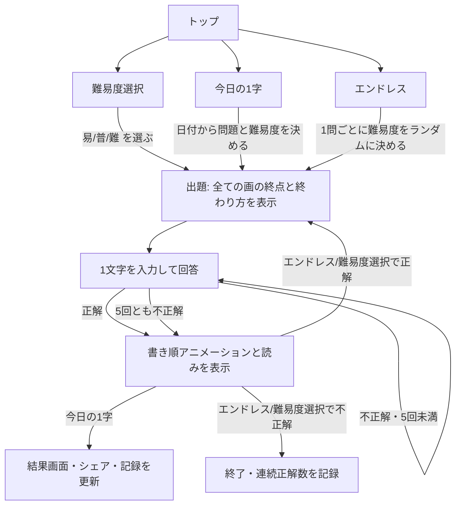

# プロダクトの目的・機能

## 目的

漢字の書き順に沿って示される「各画がどこで、どのように終わるか(とめ・はね・はらい)」だけを手がかりに、元の漢字を当てるクイズ。字形と書き順の知識を、推理しながら楽しく使えるようにする。

## 出題データ

- 出題範囲: 常用漢字 2136字
- 各画のデータ:
  - 終点の座標(正方形エリアに対する相対位置)
  - 終わり方: `とめ` / `はね` / `はらい`
  - 書き順の番号
- 書き順と線のデータは KanjiVG(CC BY-SA 3.0)を使う
- 終わり方は KanjiVG の画の種類と線の形から自動で推定し、人の目で確認して修正する。修正内容は上書き用のファイルで管理する
- 読み(音・訓)のデータを別途用意する(KANJIDIC2 などを想定)

## ゲームのルール(全モード共通)

- 問題を出した時点で、全ての画の終点と終わり方をまとめて表示する
- 難易度によって、各終点に書き順の番号を添えるかどうかが変わる(後述)
- 回答は下部の入力フォームに1文字を入れて送信する
  - 出題した漢字と完全に一致した場合のみ正解(異体字・旧字体は不正解)
  - 回答できるのは1問につき **5回まで**。5回とも外れたら不正解
- 手書きエリアはメモ用で、正誤判定には使わない
  - 機能: ペン、元に戻す、全部消す
- スコアは何回目で正解したか(1/5〜5/5、不正解は ×)
- 回答後は、正解・不正解のどちらでも次の内容を表示する
  - 正解の漢字の書き順アニメーション(正方形エリア内)
  - 読み(音・訓)

## 難易度

対象の漢字は全難易度で同じ(常用漢字全体)。書き順の番号をどれだけ見せるかだけで差をつける。

| 難易度 | 書き順の番号 |
|---|---|
| 易 | 全ての画に表示 |
| 普 | 一部の画のみ表示(1画目と最後の画) |
| 難 | 表示なし |

## モード

### 今日の1字

- 1日1問。日付から問題を決めるので、全員が同じ問題になる。日本時間の0時に切り替わる
- 難易度は日ごとにランダムに決まり、画面に表示する(全員同じ難易度)
- 1日1回だけ挑戦できる。挑戦後は当日の結果を表示する
- 結果をシェアできる(答えは伏せる。例: `今日の1字 #123 普 3/5`)。クリップボードへのコピーと X への投稿に対応
- 記録: 連続正解日数(現在と最長)、プレイ回数、正解率、何回目で当てたかの分布

### エンドレス

- 1問不正解になるまで出題を続ける
- 難易度は1問ごとにランダムに決め、画面に表示する
- 記録: 連続正解数(今回と自己ベスト)

### 難易度選択

- 開始前に 易/普/難 を選ぶ
- 選んだ難易度でエンドレスと同じルールで出題を続ける(1問不正解で終了)
- 記録: 難易度ごとの連続正解数の自己ベスト

## 成績の保存

- ブラウザ内(localStorage)にだけ保存する。アカウントやサーバーは使わない
- 同じ日に同じ漢字を何度も出さないよう、エンドレスと難易度選択では直近に出した漢字を避ける

