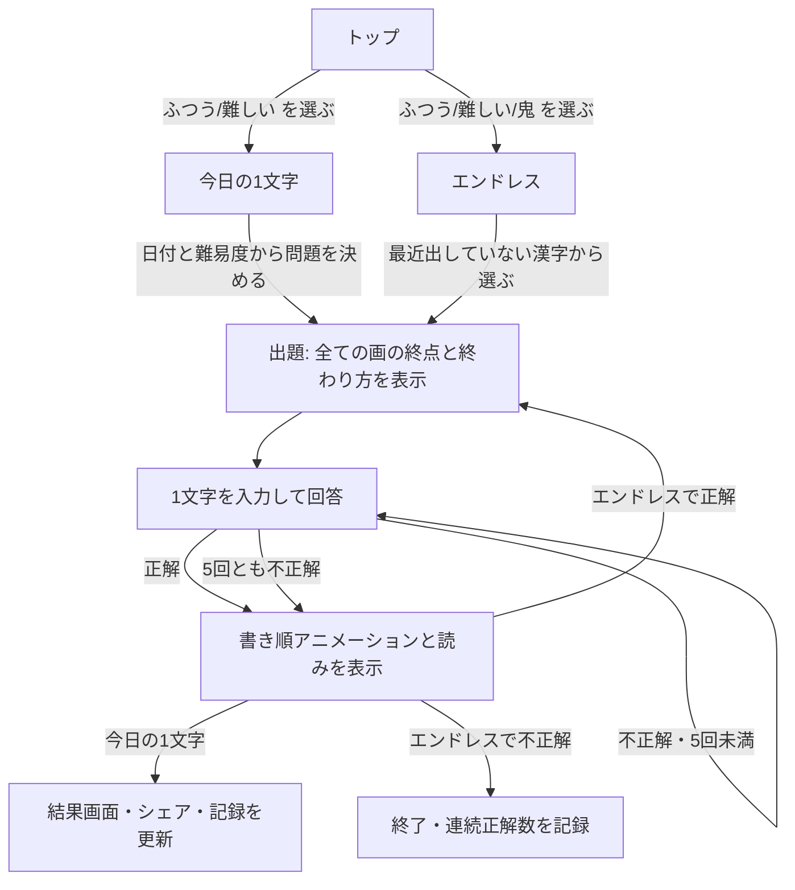

# プロダクトの目的・機能

- アプリ名: 漢字謎り(かんじなぞり)
- リポジトリ: `ur0o/kanji-nazori`

## 目的

漢字の書き順に沿って示される「各画がどこで、どのように終わるか(とめ・はね・はらい)」だけを手がかりに、元の漢字を当てるクイズ。字形と書き順の知識を、推理しながら楽しく使えるようにする。

## 出題データ

- 出題範囲: 常用漢字 2136字
- 各画のデータ:
  - 終点の座標(正方形エリアに対する相対位置)
  - 終わり方: `とめ` / `はね` / `はらい`
  - 書き順の番号
- 書き順と線のデータは KanjiVG(CC BY-SA 3.0)を使う
- 終わり方は KanjiVG の画の種類と線の形から自動で推定し、人の目で確認して修正する。修正内容は上書き用のファイルで管理する
- 読み(音・訓)のデータを別途用意する(KANJIDIC2 などを想定)

## ゲームのルール(全モード共通)

- 問題を出した時点で、全ての画の終点と終わり方をまとめて表示する
- 難易度によって、書き順の番号と終わるときの向き(矢印)を表示するかどうかが変わる(後述)
- 回答は下部の入力フォームに1文字を入れて送信する
  - 出題した漢字と完全に一致した場合のみ正解(異体字・旧字体は不正解)
  - 回答できるのは1問につき **5回まで**。5回とも外れたら不正解
- 手書きエリアはメモ用で、正誤判定には使わない
  - 機能: ペン、元に戻す、全部消す
- スコアは何回目で正解したか(1/5〜5/5、不正解は ×)
- 回答後は、正解・不正解のどちらでも次の内容を表示する
  - 正解の漢字の書き順アニメーション(正方形エリア内)
  - 読み(音・訓)

## 難易度

どのモードでも、開始前に難易度を選ぶ。ゲームの途中では変えられない。対象の漢字は全難易度で同じ(常用漢字全体)で、ヒントのうち「書き順の番号」と「終わるときの向き(矢印)」を見せるかどうかで差をつける。終点の位置と終わり方(とめ・はね・はらい)はどの難易度でも表示する。

| 難易度 | 書き順の番号 | 向き(矢印) | 選べるモード |
|---|---|---|---|
| ふつう | 表示 | 表示 | 今日の1文字・エンドレス |
| 難しい | 表示 | なし | 今日の1文字・エンドレス |
| 鬼 | なし | なし | エンドレスのみ |

## モード

### 今日の1文字

- 1日に「ふつう」「難しい」の2問。難易度ごとに別の漢字を出す(同じ日の2問で漢字は重ならない)
- 日付から問題を決めるので、同じ難易度なら全員が同じ問題になる。日本時間の0時に切り替わる
- 難易度ごとに1日1回だけ挑戦できる。挑戦後はその難易度の当日の結果を表示する
- 回答の途中経過も保存し、再読み込みしても回答回数は戻らない
- 問題番号は第1回(2026-10-26、公開前に見直す)を #1 とし、1日ごとに 1 増える。2つの難易度で共通
- 結果をシェアできる(答えは伏せる。例: `今日の1文字 #123 難しい 3/5`)。クリップボードへのコピーと X への投稿に対応
- 記録(難易度ごと): 連続正解日数(現在と最長)、プレイ回数、正解率、何回目で当てたかの分布

### エンドレス

- 「ふつう」「難しい」「鬼」から選んだ難易度で、1問不正解になるまで出題を続ける
- 記録(難易度ごと): 連続正解数(今回と自己ベスト)

## 成績の保存

- ブラウザ内(localStorage)にだけ保存する。アカウントやサーバーは使わない
- 同じ漢字を何度も出さないよう、エンドレスでは直近に出した漢字を避ける

