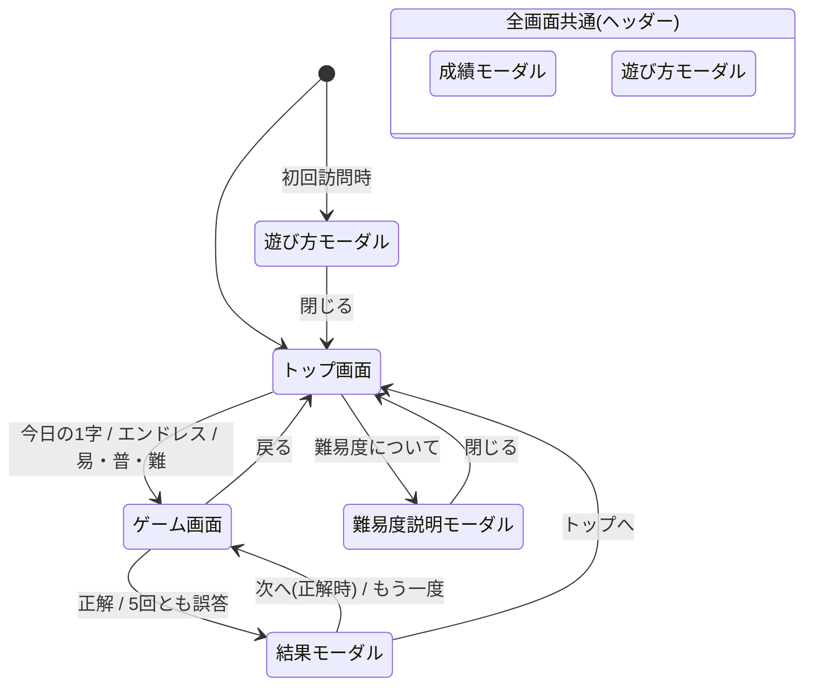

# 画面デザイン・画面遷移

## 全体方針

- テイスト: シンプル・フラット。白と黒を中心にしたミニマルな配色。ダークモードにも対応する
- スマホでの縦向きを基本にする。PC など横長の画面でも縦並びのまま、最大幅 480px 程度で中央に置く
- 正方形エリアは、画面の高さに収まるよう必要に応じて縮める
- 全画面共通のヘッダー: 左に戻る(トップ以外)、中央にタイトル、右に「?」(遊び方)と「成績」

## 画面一覧

### トップ画面

- タイトル
- 「今日の1字」ボタン。今日の問題に挑戦済みのときは結果(例: `3/5`)を添える
- 「エンドレス」ボタン
- 難易度選択: 「易」「普」「難」の3ボタンを並べ、押すとその難易度ですぐに始まる。横に「難易度について」ボタンがあり、各難易度の説明をモーダルで表示する

### ゲーム画面(全モード共通)

上から順に:

1. **情報バー**: モード名、難易度(易/普/難)、エンドレスと難易度選択では現在の連続正解数、今日の1字では問題番号(例: `#123`)
2. **正方形エリア**(画面幅いっぱい)
   - 背景に薄い十字のガイド線
   - 下のレイヤー: 手書きの線(薄い色)
   - 上のレイヤー: ヒント。手書きで隠れないよう、常に手書きの上に重ねる
   - マウスのドラッグ、またはタッチ操作で書き込める。書いている間に画面がスクロールしないようにする
3. **手書きツール**: 「元に戻す」「全部消す」
4. **回答履歴**: 5つのマスを横に並べ、誤答した漢字を×付きで左から埋めていく。横に「残り n 回」
5. **入力フォーム**: 1文字の入力欄と「回答」ボタン。Enter キーでも送信できる

#### ヒントの表示

- 各画の終点に、終わり方を表す記号を置く
  - とめ: `●`
  - はね: `⌒` 型の記号
  - はらい: `▷` 型の記号
- 記号には、その画が終わるときに進んでいた向きを示す矢印を添える。向きは8方向(上下左右と斜め)に丸める
- 書き順の番号は難易度に応じて記号の近くに小さく表示する(易=全ての画、普=1画目と最後の画、難=なし)
- 終点が近くて記号同士が重なる場合は、番号ラベルの位置をずらして読めるようにする

#### 入力のチェック

- 次の場合は回答回数を減らさず、入力欄の下にエラーを表示する
  - 空欄、2文字以上、常用漢字以外: 「常用漢字を1文字入力してください」
  - 既に回答した漢字: 「その漢字は回答済みです」
- 日本語入力の変換中に Enter を押しても送信しない

### 結果モーダル

回答が終わる(正解、または5回とも誤答)とゲーム画面の上に表示する。

- 正解・不正解の表示とスコア(例: `3/5`、不正解は `×`)
- 正解の漢字と書き順アニメーション(もう一度再生できる)
- 読み(音・訓)
- モードごとのボタン:
  - 今日の1字: 「シェア」(クリップボードにコピー / X に投稿)、「成績」、次の問題までの残り時間、「トップへ」
  - エンドレス / 難易度選択で正解: 「次へ」
  - エンドレス / 難易度選択で不正解: 今回の連続正解数と自己ベスト(更新したときはそれを示す)、「もう一度」「トップへ」
- 今日の1字に挑戦済みの日にゲーム画面を開いたときは、解き終えた状態の画面にこのモーダルを表示する

### 成績モーダル

ヘッダーの「成績」から、どの画面でも開ける。タブで切り替える。

- 今日の1字: プレイ回数、正解率、連続正解日数(現在と最長)、何回目で当てたかの分布(横棒グラフ)
- エンドレス: 自己ベストの連続正解数
- 難易度選択: 易/普/難 それぞれの自己ベストの連続正解数

### 遊び方モーダル

- 初めて訪れたときに自動で表示する。以降はヘッダーの「?」から開く
- ルールの説明と、記号(とめ・はね・はらい、矢印、番号)の見本

### 難易度説明モーダル

トップ画面の「難易度について」から開く。易/普/難 での番号の出し方の違いを、見本の図と一緒に説明する。

## 画面遷移

