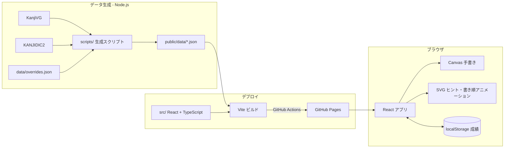

# 技術スタック

## 全体構成

- サーバーを持たない静的サイト。問題の選び方も成績の保存も、すべてブラウザ内で完結させる
- 出題データは、あらかじめスクリプトで生成した JSON をサイトと一緒に配信する
- PWA(オフライン対応・ホーム画面への追加)には対応しない
- リポジトリの `.coding-rules/typescript.md` に従う

## フロントエンド

| 用途 | 採用技術 |
|---|---|
| 言語 | TypeScript(strict モード) |
| UI ライブラリ | React |
| バンドラ | Vite |
| パッケージマネージャー | pnpm |
| ルーティング | TanStack Router(ハッシュ形式の URL) |
| UI コンポーネント | Mantine(モーダル、ボタン、タブ、入力欄など) |
| 独自のスタイル | CSS Modules |
| ダークモード | Mantine の配色切り替え(OS の設定に合わせる) |
| 状態管理 | Context API |
| データの検証 | Zod(出題 JSON と localStorage の読み込み時) |

### ルート

GitHub Pages ではページを再読み込みするとパスが見つからなくなるため、ハッシュ形式の URL にする。

| URL | 画面 |
|---|---|
| `#/` | トップ |
| `#/daily/$difficulty` | ゲーム(今日の1字。`normal`(ふつう) / `hard`(難しい)) |
| `#/endless/$difficulty` | ゲーム(エンドレス。`normal` / `hard` / `oni`(鬼)) |
| `#/credits` | クレジット |

モーダル(結果・成績・遊び方・難易度説明)には URL を割り当てない。

### 正方形エリアの描画

- 手書き: Canvas。Pointer Events を使い、マウスとタッチを同じ処理で扱う。描いている間は `touch-action: none` でスクロールを止める
- ヒントと書き順アニメーション: Canvas の上に SVG を重ねる。座標系は KanjiVG と同じ 109×109 の viewBox を使う
- 書き順アニメーション: KanjiVG の各画の path を `stroke-dasharray` / `stroke-dashoffset` で順に描く

### 今日の1字の選び方

- 常用漢字の一覧を、固定のシードで決まった順番に並べ替えておく
- サービス開始日からの経過日数(日本時間で数える)を問題番号とする
- 並べ替えた一覧を先頭から2字ずつ1日分とし、ふつう・難しいの順に割り当てる(問題番号 n の日は (n−1)×2 番目から2字)。一覧を使い切ったら先頭に戻る
- これにより、サーバーがなくても同じ難易度なら全員に同じ問題を出せ、同じ日の2問で漢字が重ならない

### 成績の保存

- localStorage にキーを1つ置き、バージョン番号付きの JSON で保存する
- 読み込み時は Zod で検証し、壊れていたら初期値で始める

## 出題データの生成

- TypeScript(Node.js)で書いたスクリプトで生成する
  - `pnpm data:fetch`: 元データを `.cache/sources/` に取得する
  - `pnpm data:build`: 出題データを生成する
- 元データ(どちらも git で取得し、再現できるようコミットを固定する)
  - KanjiVG: 書き順と各画の線(SVG)。CC BY-SA 3.0
  - KANJIDIC2 を JSON に変換した davidluzgouveia/kanji-data: 読み(音・訓)と常用漢字の一覧。元の KANJIDIC2 は CC BY-SA 4.0
- 処理の流れ
  1. KanjiVG の画の種類(`kvg:type`)から、終わり方(とめ・はね・はらい)を推定する
     - `㇑a` のような英字の接尾辞は字形の違いなので無視する
     - `㇔/㇏` のように候補が複数あり終わり方が食い違う画と、種類が不明な画は、最初の候補を使ったうえで確認対象にする
  2. 人が確認して作った修正ファイル(`data/overrides.json`)で、推定結果を上書きする
  3. 各画の path から終点の座標と、終わるときの向き(8方向)を求める
     - はねは末端の跳ね上げの向きを取るため終点の手前 3、とめ・はらいは手前 8 の区間で向きを決める(109×109 の座標系での長さ)
  4. 常用漢字だけを取り出し、次の2種類の JSON を出力する
     - `public/data/index.json`: 全字の一覧(漢字、音読み(カタカナ)、訓読み)。入力チェックと読みの表示に使う
     - `public/data/kanji/<コードポイント>.json`: 1字分のデータ(各画の path、終点、向き、終わり方)。出題時に読み込む
  5. 確認対象の画を `data/review-candidates.json` に書き出す。確認して直した画は `data/overrides.json` に追加する
- 確認・修正ページ: 自動推定を人が確認するための、公開用とは別の claude.ai の非公開ページ
  - `pnpm build:review` で `dist-review/` に出力する。各画の線・KanjiVG の画の種類・自動推定・反映済みの修正をまとめた `review-data.json` を添える
  - 漢字を「要確認 / 未確認 / 修正あり / すべて」で絞り込み、画ごとに終わり方(とめ・はね・はらい)と向き(8方向)を選び直せる。字ごとに「確認済み」を付けられる
  - 修正と確認済みの印はページの保存領域(`corrections` コレクション、字ごとに1ドキュメント)に残る
  - 保存された修正は Claude が読み取り、`pnpm review:apply <JSON>` で `data/overrides.json` に取り込んでから出題データを生成し直す。自動推定と同じ値は修正として残さない
- 出題データの形式は Zod のスキーマ(`src/lib/kanji-data.ts`)で定義し、生成時とアプリでの読み込み時の両方で検証する
- 生成した JSON はリポジトリにコミットする。ダウンロードした元データはコミットしない
- 元データ2つは CC BY-SA なので、アプリ内(クレジットページ。トップ画面のフッターからリンク)と README に出典とライセンスを書く。生成した出題データも CC BY-SA で配布する

## 品質チェック

- Vitest で単体テストを書く。主な対象:
  - 正誤判定と入力チェック
  - 日付から問題番号・漢字・難易度を決める処理(日本時間の0時の前後を含む)
  - 終点の座標と向きの計算、終わり方の推定
- 整形は Prettier、静的チェックは ESLint

## デプロイ

- GitHub Pages で公開する(`https://ur0o.github.io/kanji-kaki-quiz/`)
- ワークフローは `.github/workflows/deploy.yml`
  - `main` ブランチへのプッシュ(と手動実行)で、`pnpm lint`・`pnpm test`・`pnpm build` を通してから `dist/` をデプロイする。どれかが失敗したらデプロイしない
  - プルリクエストでは同じチェックとビルドだけを行い、デプロイはしない
- Node.js 22 と、`package.json` の `packageManager` で指定した pnpm を使う
- リポジトリの Settings → Pages で、Source を「GitHub Actions」にしておく
- ビルドは相対パス(Vite の `base: "./"`)で、URL はハッシュ形式なので、サブパスで公開しても追加の設定はいらない

## ディレクトリ構成

```
.
├── scripts/            # 出題データ生成スクリプト
├── data/
│   └── overrides.json  # 終わり方の手動修正
├── public/
│   └── data/           # 生成した出題 JSON
└── src/
    ├── layouts/        # ヘッダーなど全画面共通のレイアウト
    ├── components/     # 複数の画面で使う部品(ヒントの記号など)
    ├── pages/
    │   ├── Top/        # トップ画面
    │   └── Game/       # ゲーム画面と、そこでだけ使う部品(正方形エリア、回答履歴、結果モーダルなど)
    ├── lib/            # 問題の選び方、正誤判定、成績の保存などのロジック
    ├── router.tsx      # TanStack Router のルート定義
    └── main.tsx
```

`.coding-rules/typescript.md` のディレクトリ構成に従う。


